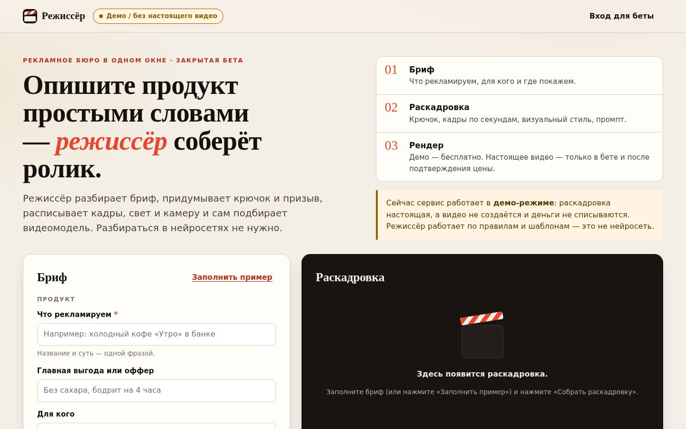
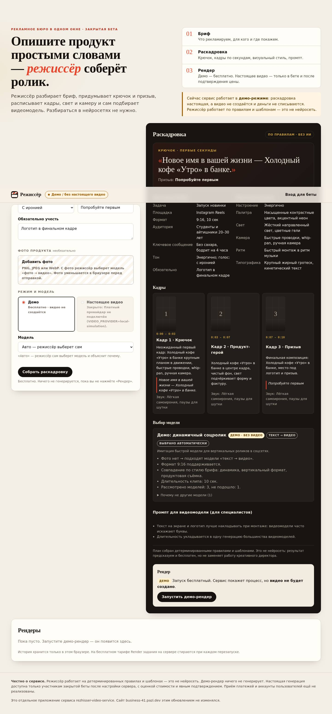
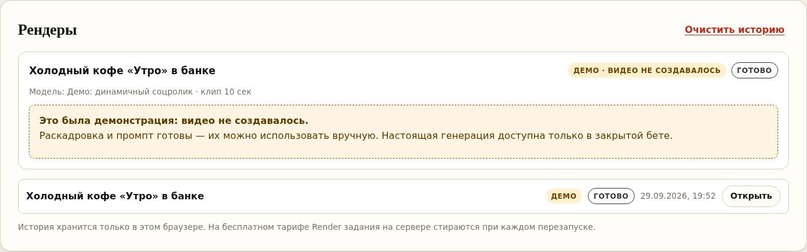

# rezhisser-video-service — «Режиссёр»

Node.js service (built-in modules only, **no dependencies**) with a Russian
web app for planning video ads. You write an ad brief in plain words. A
**rule-based director** turns it into a creative brief, a hook and call to
action, a shot list and a model prompt, then picks a video model from a
server-side allowlist and explains why.

> **Кратко по-русски.** Откройте адрес сервиса (например
> `https://rezhisser-video-service.onrender.com/`) — там приложение
> «Режиссёр». По умолчанию это **демо**: раскадровка настоящая, а видео **не
> создаётся**, деньги **не списываются**, ни Replicate, ни платные ИИ-сервисы
> не вызываются. Режиссёр работает **по правилам и шаблонам**, это не
> нейросеть. Платная генерация закрыта, пока оператор явно не настроит
> **все** предохранители (см. [пошаговую инструкцию для Render](docs/DEPLOY_RENDER.md)).

## What you get

| Part | State |
| --- | --- |
| Web app at `/` and `/app/` (Russian, responsive, accessible) | ✅ Works without any external account. |
| Rule-based director (`rule-based-v1`) | ✅ Deterministic, free, offline. Labelled as "по правилам, без ИИ". |
| Model router (auto or manual choice with a rationale) | ✅ Demo profiles by default. Paid profiles only if the operator configures them. |
| Demo render (`local-simulation`) | ✅ No network, no cost, **no video**: the result says "демонстрация: видео не создавалось". |
| Paid render via Replicate | 🔒 Locked by default. Needs a private-beta session, a quote and confirmation. Tested only with a fake API. |
| Optional LLM advisor | ⛔ Not implemented. `DIRECTOR_ADVISOR` accepts only `none`; any other value stops startup. |
| User accounts, payments, invoices | ⛔ Not implemented. The service is **not ready to sell**. |

> **Honest limitation:** no real Replicate model, price or input schema has
> been verified in this repository (replicate.com could not be reached from
> the build environment). The service therefore ships **only demo model
> profiles**. Real models must be added by the operator after checking the
> model's official API page and pricing (see
> [Model profiles](#model-profiles-video_model_profiles_json)).

## Screenshots (demo mode, local run)

| Landing and brief | Director plan (full page) | Demo result |
| --- | --- | --- |
|  |  |  |

Mobile: [plan](docs/screenshots/mobile-2-plan.jpg) · Beta login: [dialog](docs/screenshots/desktop-4-login.jpg)

## Local setup

```bash
npm start          # http://0.0.0.0:3000 — open http://localhost:3000/
npm test           # node:test, no network
```

Requires Node.js 18 or newer (the test glob needs Node 21+). There are no
dependencies to install.

## How it works

```
Brief (browser) ──► POST /api/director/plan ──► rule-based plan + model choice (free)
                    POST /api/jobs {brief}   ──► demo job (local simulation, no video)

Private beta only (paid; locked by default):
  POST /api/session {accessKey} ──► HttpOnly session cookie + CSRF token
  POST /api/quotes  {brief}     ──► operator estimate, valid for 10 min, bound to session+brief+model+image
  POST /api/jobs    {brief, quoteId, confirmPaid:true, idempotencyKey}
                                ──► spend limits checked ──► Replicate prediction
```

### The director (rule-based, not AI)

`src/director.js` validates the brief (product, offer, audience, goal,
platform, aspect ratio, duration, mood, voice, CTA, notes) and builds a plan
from fixed tables and templates:

- a hook and CTA picked from templates per goal (the user's own CTA wins), and a creative brief (objective, format, audience, key message, tone and voice, mandatory elements);
- a visual direction (mood, palette, light, camera, pacing, typography) from the mood preset;
- a shot list with visuals, camera, on-screen text and audio per shot, whose timings cover the full duration (5/10/15/30 s);
- a model prompt and negative prompt (English template wording around the user's text), plus style tags for routing.

The same brief always gives the same plan. The UI and the API label it
`engine: "rule-based-v1"` / «Правила и шаблоны (без ИИ, бесплатно)».

**LLM advisor.** The config setting `DIRECTOR_ADVISOR` is reserved for a
future optional, server-side LLM that could suggest wording. Only `none` is
supported now, and any other value makes the server refuse to start, so a
typo can never silently enable a paid API. Adding one would need its own
provider credentials, a spend cap, tests, and a UI label showing when it was
used.

### Model routing

`src/models.js` holds the allowlist. Users never type a model id, URL or token:

- **Auto**: considers only profiles of the requested tier (`demo` or `paid`).
  It rejects incompatible ones (text-to-video when a photo was uploaded,
  image-to-video without a photo, unsupported aspect ratio), then scores the
  rest by style match and duration, then by the operator's estimate. The
  response lists the rationale and the rejected models with reasons.
- **Manual**: the chosen profile is validated and is **never replaced**. If
  it doesn't fit, the user gets an error such as `image_required`.
- There is **no fallback** from demo to paid or from one paid model to
  another. The model that is billed is exactly the one shown in the quote.

Demo profiles (`demo-cinematic`, `demo-social`, `demo-product-photo`) run on
the local simulation and cost nothing.

### Model profiles (`VIDEO_MODEL_PROFILES_JSON`)

Operator-only JSON array (1–20 items). Every field is validated at startup,
and a bad profile stops the server. **The names below are placeholders, not
recommendations.** Before adding a real model, open its page on Replicate,
check the **API** tab (input field names and types), **run it once**, note
the real price, and record the date.

```json
[
  {
    "id": "t2v-main",
    "label": "Текст → видео (основная)",
    "description": "Для сюжетов без фото продукта.",
    "kind": "text-to-video",
    "replicateModel": "OWNER/MODEL",
    "input": { "prompt": "prompt", "aspectRatio": "aspect_ratio", "duration": "duration" },
    "fixedInput": {},
    "aspectRatios": ["9:16", "16:9", "1:1"],
    "aspectRatioValues": { "9:16": "9:16" },
    "durations": [5, 10],
    "strengths": ["cinematic", "people"],
    "estimatedCostUsd": { "5": 0.5, "10": 1.0 },
    "priceVerifiedAt": "YYYY-MM-DD",
    "priceSource": "https://replicate.com/OWNER/MODEL (pricing section)",
    "schemaVerifiedAt": "YYYY-MM-DD"
  },
  {
    "id": "i2v-product",
    "kind": "image-to-video",
    "replicateModel": "OWNER/MODEL:VERSION",
    "input": { "prompt": "prompt", "image": "image" },
    "durations": [5],
    "estimatedCostUsd": 0.4
  }
]
```

| Field | Meaning |
| --- | --- |
| `kind` | `text-to-video` (must not map `image`) or `image-to-video` (must map `image`; the user must upload a photo). |
| `replicateModel` | `owner/model` → `POST /models/{owner}/{model}/predictions`; `owner/model:version` → `POST /predictions` with `version`. |
| `input` | Maps the director's values onto the model's **own** input field names: `prompt` (required), `negativePrompt`, `aspectRatio`, `duration`, `image`. Unmapped values are not sent. |
| `fixedInput` | Constant scalar inputs (e.g. resolution). |
| `aspectRatioValues` | Optional translation when a model uses different values (e.g. `"16:9": "landscape"`). |
| `durations` | Clip lengths the model can produce. Longer ads get the nearest shorter clip, and the UI says so. |
| `estimatedCostUsd` | **Operator's estimate** per clip (number, or object keyed by duration). A paid profile without an estimate can't be quoted. |

The uploaded photo (PNG/JPEG/WebP, checked by magic bytes, default limit
256 KB, compressed in the browser) is sent to the model as a `data:` URL.
Check the model's documentation for the image input formats and size limits
it accepts.

Legacy setup: if `VIDEO_MODEL_PROFILES_JSON` is empty, `REPLICATE_MODEL`
becomes the single `replicate-default` text-to-video profile (input: `prompt`
plus `REPLICATE_EXTRA_INPUT_JSON`). Its estimate comes from
`REPLICATE_ESTIMATED_COST_USD`.

## Safety model for paid generation

Paid generation is available **only if all** of these are true (see
`GET /api/config` → `paid.reasons` for what is missing):

1. `VIDEO_PROVIDER=replicate` with a valid `REPLICATE_API_TOKEN` and at least one paid profile;
2. `PAID_GENERATION_ENABLED=true`;
3. `BETA_ACCESS_KEY` is set (≥ 24 characters, random);
4. `PAID_DAILY_BUDGET_USD` > 0 (plus `PAID_DAILY_JOB_LIMIT` / `PAID_TOTAL_JOB_LIMIT`);
5. at least one paid profile has `estimatedCostUsd`.

Even then, each paid job requires all of the following:

- **Private-beta session.** `POST /api/session` with the access key, from the
  service's own page (same `Origin`), rate limited per IP and globally. The
  server compares the key with HMAC and `timingSafeEqual` and creates a random
  in-memory session in an `HttpOnly; SameSite=Strict` cookie (`Secure` behind
  HTTPS). The key is never stored in the browser, the URL or the page.
- **CSRF protection.** Every state-changing session request needs the
  `X-CSRF-Token` header and `Origin` equal to the service's own origin. No
  cross-origin request can use the session: CORS never sends
  `Access-Control-Allow-Credentials`.
- **Server-issued quote.** It is bound to the session, profile, brief hash,
  image hash and clip length. It is valid for `QUOTE_TTL_MS` and single-use.
  The user must tick the checkbox and press the confirm button
  (`confirmPaid: true`). Price, cost, model and input fields sent by the
  client are rejected (`field_not_allowed`).
- **Idempotency key.** Repeating it returns the same job (`200
  idempotentReplay`) instead of starting a second prediction. The browser
  keeps the key on retry after a timeout.
- **Server-side limits, checked synchronously before the provider call:**
  the daily USD budget, daily job count, total job count, and
  `REPLICATE_MAX_CONCURRENT` (extra jobs get `503 provider_busy`). The
  estimate is counted when the job starts, **even if it later fails**.
- **Public API is demo-only.** The legacy prompt API (`POST /api/jobs
  {prompt}`) can never start a paid prediction (`401`). Paid jobs, briefs and
  plans are hidden from anonymous `GET /api/jobs`.

What this does **not** give you, read carefully:

- It is **not a provider-side spend cap**. The ledger counts the operator's
  *estimates*, not Replicate invoices. Also set a low limit in your Replicate
  billing settings, and don't rely on any vendor cap unless the vendor
  documents it for your account.
- **A timeout, cancel, error or restart may NOT reverse charges.** Replicate
  may bill for a prediction that already started. Jobs interrupted by a
  restart are marked `provider_interrupted` and are **not** retried.
- Sessions and quotes live in memory. The ledger and jobs are files in
  `DATA_DIR`. On the Render free plan the disk is **ephemeral**, so a
  restart, deploy or idle spin-down resets the daily/total counters and the
  job history. Use a persistent disk if you rely on these counters. Run
  **one instance only**, because nothing is shared between instances.
- One shared key is **not** a user-account system. Everyone with the key has
  the same rights and there is no per-user attribution.

**Before selling to the public** you still need: real user accounts
(registration, password reset or OAuth, per-user sessions), payments
(e.g. Stripe) with per-user prepaid credits deducted atomically in a database,
per-user quotas, persistent storage (a database plus object storage for
outputs, because provider output URLs may be temporary), provider webhooks with
signature checks, reconciliation against real provider invoices, terms of
service and a content moderation policy, monitoring and alerts, and a legal
review for your jurisdiction.

## Environment variables

| Variable | Default | Description |
| --- | --- | --- |
| `HOST` / `PORT` | `0.0.0.0` / `3000` | Bind address (Render sets `PORT`). |
| `ALLOWED_ORIGINS` | `https://business-41.pazi.dev` + local dev origins | CORS allowlist for **other** sites (demo API only, no credentials). The service's own page doesn't need to be listed. |
| `RATE_LIMIT_MAX` / `RATE_LIMIT_WINDOW_MS` | `30` / `60000` | Per-IP limit for `/api/*`. |
| `DATA_DIR` | `<cwd>/data` | Job files and `spend-ledger.state`. |
| `SIMULATION_DURATION_MS` | `3000` | Demo job duration. |
| `VIDEO_PROVIDER` | `local-simulation` | `local-simulation` or `replicate`. |
| `DIRECTOR_ADVISOR` | `none` | Only `none` is supported; any other value fails startup. |
| `VIDEO_MODEL_PROFILES_JSON` | – | Paid model allowlist (see above). Used only when `VIDEO_PROVIDER=replicate`. |
| `PAID_GENERATION_ENABLED` | `false` | Must be exactly `true` to unlock paid jobs. |
| `BETA_ACCESS_KEY` | – | **Secret.** ≥ 24 characters. Set it only in the Render dashboard. |
| `PAID_DAILY_BUDGET_USD` | `0` (locked) | Daily limit on the sum of estimates (UTC day). |
| `PAID_DAILY_JOB_LIMIT` | `3` | Paid jobs per UTC day (1–100). |
| `PAID_TOTAL_JOB_LIMIT` | `20` | Paid jobs in total, for as long as the ledger file survives (1–10000). |
| `QUOTE_TTL_MS` | `600000` | Quote lifetime (1–60 min). |
| `SESSION_TTL_MS` | `28800000` | Beta session lifetime (5 min – 24 h). |
| `LOGIN_RATE_LIMIT_MAX` / `LOGIN_RATE_LIMIT_WINDOW_MS` | `5` / `900000` | Login attempts per IP (global limit is 10×). |
| `IMAGE_MAX_BYTES` | `262144` | Max decoded upload size (16 KB – 5 MB). |
| `PUBLIC_ORIGIN` | – | Optional. Explicit origin (e.g. `https://rezhisser-video-service.onrender.com`, no path) used for the same-origin check and the `Secure` cookie flag; an invalid value stops startup. Otherwise it is derived from `Host` and `X-Forwarded-Proto`. |
| `REPLICATE_API_TOKEN` | – | **Secret.** Server-side only. |
| `REPLICATE_MODEL` | – | Legacy single model (`owner/model[:version]`). |
| `REPLICATE_ESTIMATED_COST_USD` | – | Estimate for the legacy profile. |
| `REPLICATE_EXTRA_INPUT_JSON` | – | Fixed inputs for the legacy profile. |
| `REPLICATE_API_BASE_URL` | `https://api.replicate.com/v1` | Must be `https`. |
| `REPLICATE_POLL_INTERVAL_MS` | `5000` | 1000–60000. |
| `REPLICATE_MAX_WAIT_MS` | `600000` | 10 s – 30 min. On timeout the prediction is cancelled (best effort; may still be billed). |
| `REPLICATE_REQUEST_TIMEOUT_MS` | `30000` | Per HTTP request. |
| `REPLICATE_MAX_CONCURRENT` | `1` | Concurrent predictions (1–10). |

## API

| Method | Path | Description |
| --- | --- | --- |
| `GET` | `/`, `/app/` | Web app (strict CSP, no inline scripts, no third-party origins). |
| `GET` | `/api/health` | `{ status, uptimeSeconds, timestamp, videoProvider, realVideoGeneration, paidGenerationEnabled }`. Render health check. |
| `GET` | `/api/config` | Brief options, public model profiles, director info, `paid: {available, reasons}`, auth state. Contains no secrets. |
| `POST` | `/api/director/plan` | `{ brief, modelId?, tier?, hasImage? }` → `{ plan, selection }`. Free. |
| `GET/POST/DELETE` | `/api/session` | Beta login/logout (same-origin only; DELETE needs CSRF). |
| `POST` | `/api/quotes` | Beta + CSRF. `{ brief, modelId?, image? }` → `{ quote, plan, selection, spend }`. |
| `POST` | `/api/jobs` | `{ brief, modelId?, image? }` → demo job. Paid: add `tier:"paid"`, `quoteId`, `confirmPaid:true`, `idempotencyKey`. Legacy `{ prompt, provider? }` still works for the local simulation. |
| `GET` | `/api/jobs`, `/api/jobs/:id` | Anonymous users see only demo jobs; paid jobs need a session. |

Every job says explicitly what it is: `provider`, `simulated`,
`realVideoGeneration`, `paid`, `modelId`. A demo job always ends with
`result: { simulated: true, videoUrl: null }`. The UI shows a player and a
download link **only** for a real `https` video URL.

## Using it from business-41.pazi.dev

The new app is served **by this Render service** (same origin). **The Pazi
site has not been changed by this repository**, and its own `/app/` is a
separate thing. Options for the next step, done separately in the Pazi
project:

1. **Link** from Pazi to `https://rezhisser-video-service.onrender.com/app/`
   (simplest, and all features work, including beta login).
2. **Call the demo API** from Pazi's frontend (`/api/director/plan`,
   `POST /api/jobs {brief}` or legacy `{prompt}`). The origin is already in
   `ALLOWED_ORIGINS`. Paid actions are **not** available cross-origin by
   design (SameSite=Strict cookie, no credentialed CORS).
3. Paid generation from Pazi would require real accounts on a shared domain or
   a server-to-server integration with its own authentication. That isn't
   built.

Note: when `VIDEO_PROVIDER=replicate`, the legacy `POST /api/jobs {prompt}`
without `provider` returns `401` (it would otherwise be billable). Clients
should send `provider: "local-simulation"` or use the brief flow.

## Deploying to Render

See **[docs/DEPLOY_RENDER.md](docs/DEPLOY_RENDER.md)** (Russian, step by step)
for the existing, **manually created** Web Service. `render.yaml` is only used
by Render Blueprints. It is **not** applied to a service created manually in
the dashboard, so env vars must be set there by hand.

## Tests

`npm test` runs everything with injected fake `fetch`. No token, no network,
no billing:

- `test/e2e.test.js`: health, CORS, preflight, security headers, rate limit, legacy simulation jobs.
- `test/replicate.test.js`: the Replicate adapter (create/poll, timeouts, cancel, errors, URL extraction), plus the gated beta flow end to end, concurrency cap and restart interruption.
- `test/director.test.js`: determinism, validation, shot timings, "rule-based" labelling, fail-closed advisor setting.
- `test/models.test.js`: profile validation, auto/manual routing, no cross-tier fallback, per-model input mapping, and the **actual endpoint URL and request body** reaching the fake provider for versioned and unversioned profiles.
- `test/auth-spend.test.js`: locked-by-default reasons, each missing safeguard, and that unauthenticated, CSRF-less, cross-origin and legacy requests cause **zero predictions**. Also login rate limit, cookie flags, quotes (mismatch, expiry, single use, other session), idempotent replay, budget and job caps, ledger persistence, and private job listings.
- `test/frontend.test.js`: UI routes and CSP, static allowlist (no traversal), no `innerHTML`/`eval`/third-party origins, no secrets in assets, every referenced element exists, accessibility basics, and a demo flow with network disabled.
